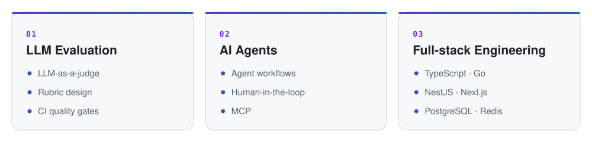
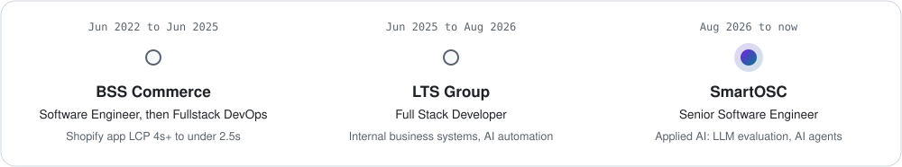

<picture>
  <source media="(prefers-color-scheme: dark)" srcset="https://raw.githubusercontent.com/yenpham103/yenpham103/main/assets/header-dark.svg" />
  
</picture>

  

&nbsp;

 

I build the evaluation and workflow infrastructure that makes **LLM features and AI agents reliable enough to ship**.

 

## Focus areas

<picture>
  <source media="(prefers-color-scheme: dark)" srcset="https://raw.githubusercontent.com/yenpham103/yenpham103/main/assets/focus-dark.svg" />
  
</picture>

## Experience

<picture>
  <source media="(prefers-color-scheme: dark)" srcset="https://raw.githubusercontent.com/yenpham103/yenpham103/main/assets/experience-dark.svg" />
  
</picture>

## Tech stack

  
  
  
  
  
  
  
  

   
   
  

Contribution graph

 
<picture>
  <source media="(prefers-color-scheme: dark)" srcset="https://raw.githubusercontent.com/yenpham103/yenpham103/main/profile-3d-contrib/profile-night-green.svg" />
  
</picture>

