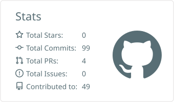
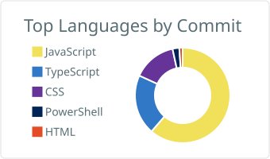
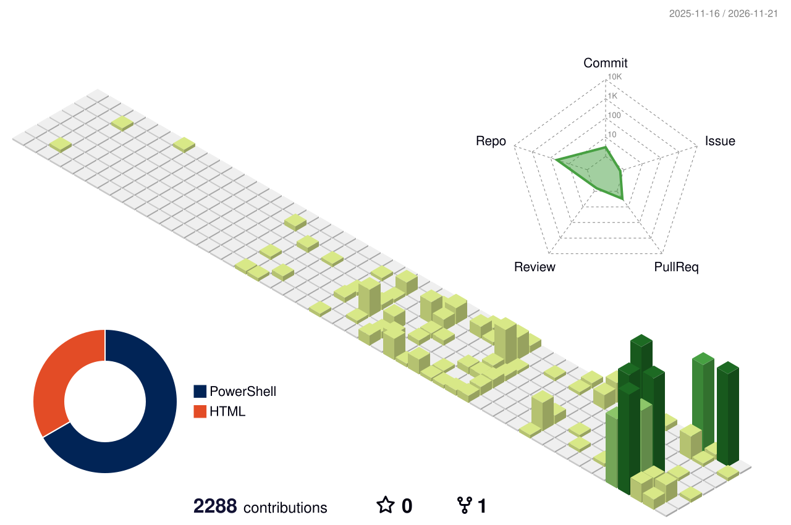

# Yen Pham

**Senior Software Engineer** at SmartOSC, working on applied AI · Hanoi, Vietnam

[phamyen100301@gmail.com](mailto:phamyen100301@gmail.com) · [LinkedIn](https://www.linkedin.com/in/yenphamdev/)

I build the evaluation and workflow infrastructure that makes LLM features and AI agents reliable enough to ship. My background is 4+ years of full-stack TypeScript, from database design to UI and deployment.

## Current work

Applied AI engineering and research at SmartOSC, focused on LLM evaluation and AI agents.

**LLM evaluation platform**
- Architected and built it from scratch to production with NestJS and Next.js.
- Integrated into CI pipelines, so AI quality regressions are caught before code is merged.
- LLM-as-a-judge scoring on a shared rubric bank, validated against human reviewer agreement.
- Benchmarked open-source evaluation tools and judge models.
- Wrote the Go SDK and language-agnostic evaluation harnesses, including support for multi-step agent workflows.

**AI-DLC workflow platform**
- Workflows designed on a visual canvas become kits of agents, skills, review gates and golden test cases.
- Each version must pass its evaluations before it can be activated.
- Live runs pause at review gates for human approval.

**MCP server for coding agents**
- Gives Claude Code, Cursor and Codex access to each project's knowledge base, requirements and tickets.

These are internal SmartOSC projects, so the source code is private.

## How I build AI systems

- **Evaluations gate releases.** A workflow version does not go live until it passes its evals.
- **Judges earn trust.** A judge model's scores count only after they agree with human reviewers.
- **Humans stay in the loop.** Agent runs stop at review gates until a person approves.

## Previous experience

**Full Stack Developer**, LTS Group · Jun 2025 to Aug 2026
- Built internal contract, invoicing and budget planning systems with Next.js, NestJS and PostgreSQL.
- Integrated them with Microsoft Graph and Microsoft Teams.
- Built custom AI agents and automated pipelines for the team's development workflow.
- Found and fixed a critical unauthenticated remote code execution vulnerability in the HR system, and added two-factor authentication.

**Software Engineer, then Fullstack DevOps Engineer**, BSS Commerce · Jun 2022 to Jun 2025
- Improved a public Shopify app's LCP from over 4s to under 2.5s to meet the Built for Shopify requirements.
- Built internal admin and customer insight tools.
- Ran CI/CD, deployments and monitoring with Jenkins, GitLab CI/CD, Nginx and Zabbix.

## Tech stack

| Area | Tools |
|---|---|
| AI / LLM | LLM evaluation, LLM-as-a-judge, AI agents, MCP, LiteLLM, OpenAI / Gemini / Claude APIs |
| Languages | TypeScript, JavaScript, Go, SQL |
| Backend | Node.js, NestJS, FastAPI, REST APIs, WebSockets, Bull, RabbitMQ |
| Frontend | Next.js, React, TanStack Query, Tailwind CSS, shadcn/ui |
| Data | PostgreSQL, MySQL, MongoDB, Redis, Prisma, Drizzle, TypeORM |
| Infrastructure | Docker, GitLab CI/CD, Jenkins, Nginx, Cloudflare, Linux |
| Tools | Claude Code, Cursor, Git, Jest, Vitest |

## GitHub activity

Most of my recent work lives in private repositories, so these cards reflect public activity only.

  <picture>
    <source media="(prefers-color-scheme: dark)" srcset="https://raw.githubusercontent.com/yenpham103/yenpham103/main/profile-summary-card-output/github_dark/3-stats.svg" />
    
  </picture>
  <picture>
    <source media="(prefers-color-scheme: dark)" srcset="https://raw.githubusercontent.com/yenpham103/yenpham103/main/profile-summary-card-output/github_dark/2-most-commit-language.svg" />
    
  </picture>

Contribution graph

 
<picture>
  <source media="(prefers-color-scheme: dark)" srcset="https://raw.githubusercontent.com/yenpham103/yenpham103/main/profile-3d-contrib/profile-night-green.svg" />
  
</picture>

